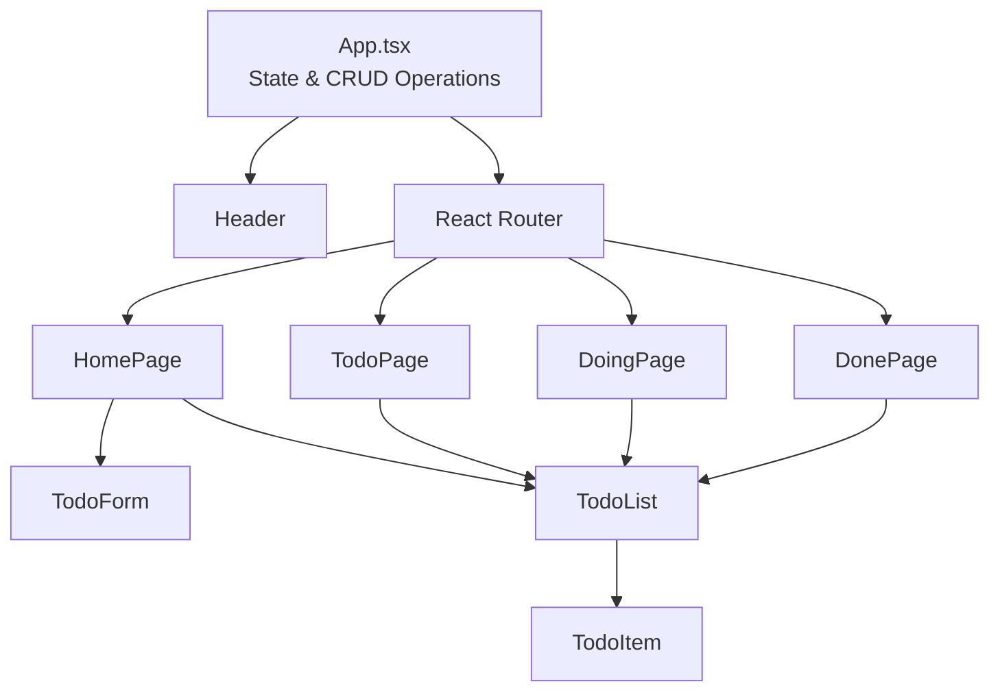
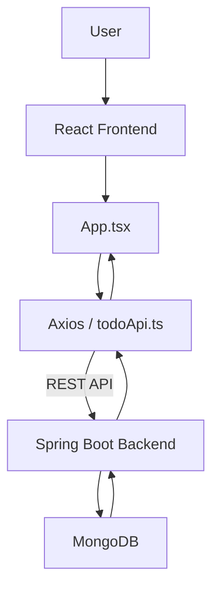

# Super Kanban – Todo Application

A full-stack Todo application built with **React, TypeScript, Spring Boot, and MongoDB**.

The application allows users to create, view, update, and delete tasks. Tasks are organized into three categories: **Todo**, **In Progress**, and **Done**, using a Kanban-style board.

## Features

- Create new tasks
- View all tasks
- Edit task descriptions and statuses
- Delete tasks
- Organize tasks by status
- Navigate between different pages
- Communicate with a REST API backend
- Store tasks in MongoDB

## Technologies

### Frontend
- React
- TypeScript
- Vite
- React Router
- Axios
- CSS

### Backend
- Java
- Spring Boot
- Spring Data MongoDB
- MongoDB

## Project Structure

```text
src/
├── components/
│   ├── Header.tsx
│   ├── TodoForm.tsx
│   ├── TodoItem.tsx
│   └── TodoList.tsx
├── pages/
│   ├── HomePage.tsx
│   ├── TodoPage.tsx
│   ├── DoingPage.tsx
│   └── DonePage.tsx
├── services/
│   └── todoApi.ts
├── types/
│   └── Todo.ts
├── App.tsx
├── App.css
└── main.tsx
```

## Getting Started

### Prerequisites

Make sure you have the following installed:

- Node.js
- npm
- Java
- Maven
- MongoDB

### 1. Start the Backend


Clone the backend repository:

```bash
git clone https://github.com/MerveKardes/ToDoProject.git
```

Navigate to the backend project directory:

```bash
cd TodoProject
```

Start the Spring Boot application using IntelliJ IDEA or Maven:

```bash
./mvnw spring-boot:run
```

The backend runs at:

`http://localhost:8080`


### 2. Start the Frontend

Clone the repository:

```bash
git clone https://github.com/MerveKardes/todo-frontend.git
```

Navigate to the frontend project directory:

```bash
cd todo-frontend
```

Install dependencies:

```bash
npm install
```

Start the development server:

```bash
npm run dev
```

Open the local URL provided by Vite, usually:

```text
http://localhost:5173
```

## API Endpoints

The frontend communicates with the backend through the following REST API endpoints:

| Method | Endpoint | Description |
|---|---|---|
| GET | `/api/todo` | Get all tasks |
| POST | `/api/todo` | Create a new task |
| GET | `/api/todo/{id}` | Get a task by ID |
| PUT | `/api/todo/{id}` | Update a task |
| DELETE | `/api/todo/{id}` | Delete a task |

## Task Statuses

Each task has one of the following statuses:

- `TODO` – Tasks that have not been started.
- `IN_PROGRESS` – Tasks that are currently being worked on.
- `DONE` – Completed tasks.

## Application Pages

- **Home:** Displays all tasks in a Kanban board with three columns.
- **Todo:** Displays tasks waiting to be started.
- **Doing:** Displays tasks currently in progress.
- **Done:** Displays completed tasks.

## Architecture

### 1. Frontend Component Structure

The frontend follows a component-based architecture. The main application component manages the state and CRUD operations, while reusable components handle the user interface.



### 2. Backend Communication

The frontend communicates with the Spring Boot backend through REST API endpoints using Axios. The backend handles requests and stores task data in MongoDB.



## Component Responsibilities

| Component | Responsibility |
|---|---|
| `App.tsx` | Manages application state, CRUD operations, and routing. |
| `Header` | Provides navigation between pages. |
| `HomePage` | Displays all tasks in three Kanban columns. |
| `TodoPage` | Displays tasks with TODO status. |
| `DoingPage` | Displays tasks with IN_PROGRESS status. |
| `DonePage` | Displays completed tasks. |
| `TodoForm` | Handles creating new tasks. |
| `TodoList` | Renders a list of tasks. |
| `TodoItem` | Displays and manages an individual task. |
| `todoApi.ts` | Handles communication with the backend API. |

## License

This project was created for learning and educational purposes.